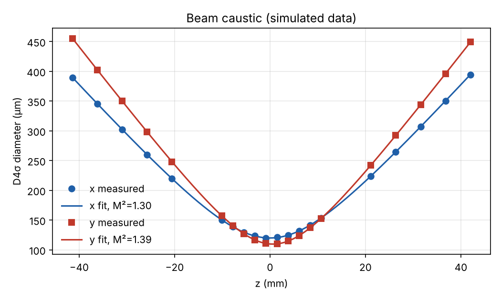

# beam-profiler

A camera based laser beam profiler with an automated through focus scan. A
bare webcam sensor rides on an Arduino driven lead screw stage, steps through
the focus of a laser, and at every position I measure the beam diameter with
ISO 11146 second moments. Fitting the caustic gives the waist size, waist
position, Rayleigh length, divergence and M² in both axes.



## What it measures

| Quantity | How |
|---|---|
| Centroid, D4σ diameter in x and y | first and second moments of the background corrected image, inside an iteratively refined aperture three times the beam diameter |
| Principal axis diameters, orientation, ellipticity | eigen decomposition of the second moment matrix |
| Gaussian 1/e² diameters and fit residual | rotated elliptical 2D Gaussian fit, used as a cross check on D4σ |
| Waist d0, waist position z0, divergence θ, Rayleigh length zR, M² | least squares fit of d(z)² = d0² + θ²(z − z0)² per axis |
| Astigmatism | difference between the x and y waist positions |

D4σ is the primary width because it is defined for any beam shape. If the
Gaussian fit disagrees with it by more than 5 percent, the beam has side lobes
or higher order content and the script says so.

## Where things live

```
beamprofiler/   moments.py   ISO 11146 second moments
                gaussfit.py  2D Gaussian cross check
                caustic.py   caustic fit, M², ISO scan planning
                camera.py    webcam capture with gamma and channel handling
                stage.py     serial stage driver
                simulate.py  camera model for synthetic frames
scripts/        scan.py               full through focus scan (hardware or --simulate)
                profile_frame.py      measure one image
                linearity.py          measure webcam gamma
                validate_pipeline.py  Monte Carlo accuracy check against ground truth
firmware/       stage_controller.ino  Arduino stepper controller with backlash compensation
matlab/         fit_caustic.m, profile_frame.m  same analysis in base MATLAB (also runs in Octave)
tests/          pytest suite
docs/           hardware.md  bill of materials, calibration and laser safety
```

## Try it

```bash
pip install -r requirements.txt
python -m pytest                                   # 8 tests
python scripts/scan.py --simulate --iso-refine     # end to end on synthetic data
python scripts/validate_pipeline.py --runs 40      # accuracy of the method
```

With the rig built and the firmware flashed:

```bash
python scripts/linearity.py --camera 0 --exposures -10 -9 -8 -7 -6
python scripts/scan.py --port /dev/ttyACM0 --camera 0 --gamma 2.2 \
    --pixel-um 3.0 --z-start -40 --z-stop 40 --points 21 --iso-refine
```

In MATLAB or Octave:

```matlab
cd matlab
fit_caustic('../results/scan.csv', 650)
```

## Validating the method before the hardware

I wrote a camera model (Poisson shot noise, read noise, dark offset, 8 bit
quantisation and saturation) and generated scans of a beam with known
parameters, then ran them through exactly the same code the hardware uses.
Over 40 independent noisy ISO spaced scans of 20 positions each:

| Quantity | Truth | Recovered mean | Bias | Std dev |
|---|---|---|---|---|
| d0, x | 120.0 µm | 120.04 µm | +0.03 % | 0.11 µm |
| d0, y | 110.0 µm | 109.95 µm | −0.05 % | 0.12 µm |
| z0, y | 0.600 mm | 0.600 mm | +0.06 % | 0.006 mm |
| M², x | 1.300 | 1.299 | −0.07 % | 0.001 |
| M², y | 1.400 | 1.398 | −0.15 % | 0.001 |

The MATLAB fit of the same scan agrees with Python to the printed precision.
These are simulated numbers, so they show the analysis is correct and set a
floor on noise driven error. On the real rig I expect the error budget to be
dominated by things the simulation leaves out: webcam gamma, Bayer filtering,
stage pitch and backlash, and stray light. Those are covered in
[docs/hardware.md](docs/hardware.md).

## Hardware results

To be added once the rig is built: caustic plot, M² in x and y, and a
comparison of the measured waist against the 4M²λf/(πD) estimate.

## References

ISO 11146-1:2021, Lasers and laser related equipment: test methods for laser
beam widths, divergence angles and beam propagation ratios.

---

If something here is unclear, broken, or just wrong, feel free to open an issue. I'm always happy to chat about it.
